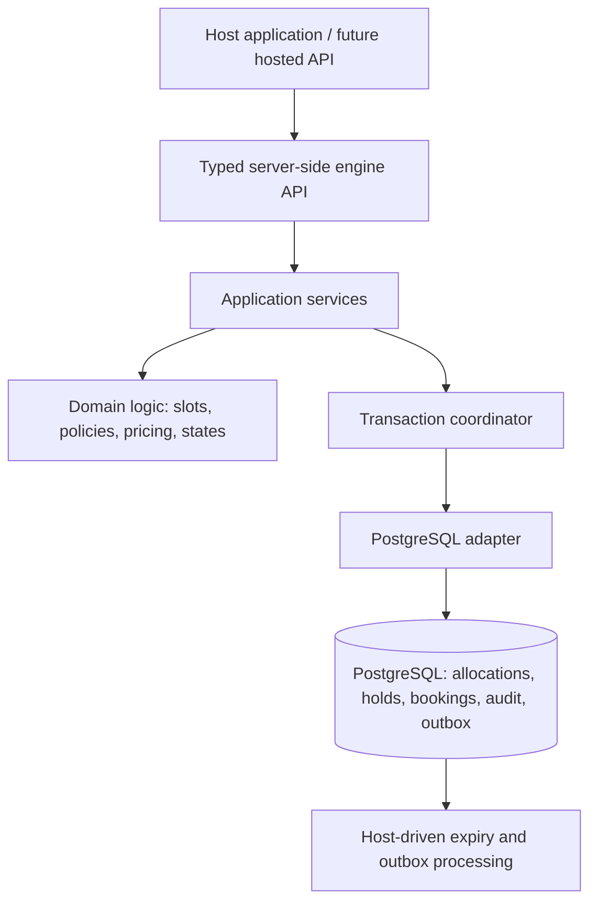

# AGENTS.md — Time-slot Booking Engine

**Specification:** v1.0 (revised)  
**Current scope:** Model 2 — fixed-duration time slots with exclusive facility allocation  
**Distribution:** server-side TypeScript npm package with PostgreSQL persistence  
**Status:** implementation specification; not a claim of implemented or tested software

This document is the authoritative instruction set for coding agents implementing the time-slot booking module. The words MUST, MUST NOT and SHOULD indicate mandatory requirements, prohibitions and recommended practices respectively. If existing code conflicts with a mandatory invariant, report the conflict and propose a migration before changing behavior.

## 1. Project mission and scope

Build a developer-first booking engine that can be embedded into a host application today and operated behind a hosted Booking Infrastructure as a Service (BIaaS) API in the future. The core engine must not depend on HTTP, a frontend, a specific authentication service, or a payment gateway.

### 1.1 Product roadmap

1. Appointment-based booking
2. **Time-slot-based booking — current implementation scope**
3. Resource-based booking
4. Seat-based booking
5. Capacity-based booking
6. Date-range-based booking
7. Rental-based booking
8. Event-based booking
9. Multi-resource booking
10. Table-based booking

These are commercial use cases, not ten mutually exclusive technical engines. A time-slot booking already uses a resource and an allocation strategy. Reuse genuinely shared primitives only when required by the current implementation. Do not scaffold, implement or design the other nine models prematurely.

### 1.2 Current booking contract

V1 supports a specific, independently bookable facility (football turf, badminton court, gaming station, sports facility, rehearsal room or similar). A tenant configures local opening hours, a fixed slot duration, start cadence, prices and booking policies. A customer selects one slot or a contiguous sequence of non-overlapping slots on the same facility.

- One exclusive facility per hold or booking; quantity is always one.
- Each selected slot must be a valid candidate under the effective configuration.
- All selected slots succeed together or none succeeds.
- Multiple facilities, automatically assigned inventory, shared capacity, recurring customer bookings and disjoint slot selections are out of scope.
- Weekly recurring operating schedules are in scope; recurring customer reservations are not.
- Payment processing, refunds and customer authentication are host-application responsibilities.
- The embedded engine is server-only. The hosted API, dashboard, marketplace, billing, wallets, notifications transport and other booking models are deferred.

Example: Court A operates 06:00–23:00 in Asia/Kolkata with 60-minute slots. A customer selects 18:00–19:00 and 19:00–20:00. The engine creates one hold covering the combined interval (plus configured outer buffers), then atomically converts it into a confirmed booking. A competing request for any overlapping occupied interval must fail.

### 1.3 Release boundaries

- **M1 — first working vertical slice:** tenant and facility setup; weekly schedule; slot generation; availability; transactional hold, expiry, conversion and cancellation; fixed prices; database-enforced exclusivity; idempotency; real PostgreSQL tests; a runnable example. This is a private development milestone, not a complete release.
- **V1 — releasable package:** all MUST requirements in this document, including schedule exceptions, overnight and DST handling, explicit slot overrides, safe configuration changes, structured diagnostics, lifecycle operations, audit, durable outbox and migration/packaging tests.
- **V1.1 — planned extension:** atomic same-facility rescheduling. The required future behavior is described in §9.4; do not expose a nonworking reschedule API in V1.
- Do not advance to another booking model until V1 meets its definition of done.

## 2. Engineering principles and architecture

1. Correctness before features: never sacrifice inventory integrity for latency or convenience.
2. PostgreSQL is the authoritative source for allocation, expiry, state and durable events. An availability result is not a reservation.
3. All related mutations are atomic. No successful operation may leave a partial booking, orphan allocation or duplicate commercial record.
4. Tenant isolation is enforced in the engine, data-access layer and database relationships.
5. UTC instants are used for conflicts; local IANA time zones are used for schedules and business dates.
6. Intervals are half-open `[start, end)`. Adjacent intervals do not conflict unless their occupied ranges overlap.
7. Mutations are idempotent, auditable and deterministic under retries.
8. Public APIs are typed, runtime-validated, documented and backward-compatible within a major version.
9. The engine has no external network calls inside its booking transactions.
10. Prefer small, testable modules and one transactional database. Do not add distributed locks, microservices, Redis, Kafka, Kubernetes or other infrastructure without a demonstrated requirement and an approved architecture decision.

### 2.1 Logical architecture



The domain module must not import the HTTP layer, ORM-specific objects or host authentication code. Application services coordinate authorization, validation, transactions and domain logic. The PostgreSQL adapter owns SQL, constraints, lock acquisition and error translation.

### 2.2 Technology direction

Use existing repository conventions where established. For a new repository, prefer strict TypeScript, supported Node.js LTS, pnpm, PostgreSQL, explicit SQL or Drizzle, runtime validation using Zod or an equivalent library, and Vitest. Use workspace tooling only when multiple packages justify it. Fastify may be considered for a future HTTP wrapper, not this release.

The first supported storage implementation is PostgreSQL only. A storage interface must express transaction and locking semantics rather than generic CRUD. It must support tenant-scoped transactions, deterministic locking, authoritative time, atomic allocation, consistent state updates, idempotency and outbox persistence. Do not claim portability to another database unless that adapter passes the same real concurrency and integrity tests.

### 2.3 Recommended repository structure

```text
booking-engine/
  AGENTS.md
  README.md
  packages/
    core/           # domain primitives required by time-slot booking
    time-slot/      # application services and public API
    postgres/       # adapter and SQL migrations
  examples/
    football-turf/
  tests/
    integration/
    concurrency/
    regression/
  docs/
    api.md
    scheduling.md
    concurrency.md
    security.md
    decisions/
```

A single package with equivalent internal modules is acceptable initially. Do not create empty packages solely to match this diagram.

## 3. Domain model and terminology

| Concept | Contract |
|---|---|
| Tenant | Business isolation boundary; owns all engine data. |
| Facility | A single exclusive bookable resource. Venue/location metadata is optional; a facility belongs to exactly one tenant. |
| Schedule | Versioned local operating windows for a facility, with weekday rules and local effective dates. |
| Schedule exception | Date-specific replacement of normal windows for a business date, including full closure. |
| Slot policy | Duration, cadence, minimum notice, horizon, buffers, booking size and hold expiry rules. |
| Slot candidate | An available or unavailable candidate interval generated from a schedule or explicit override. It is not itself reserved inventory. |
| Slot override | Explicitly configured candidate interval added or suppressed under the current schedule revision. |
| Facility block | A hard prohibited interval such as maintenance, holiday closure or private event. |
| Hold | Temporary, expiring reservation intent with selected slots and an immutable price snapshot. |
| Booking | Confirmed commercial record created from a hold or a permitted direct workflow. |
| Booking item | The immutable selected slot interval and its individual price snapshot. |
| Allocation | Actual occupied interval, including outer buffers, exclusively protected against conflicting allocations. |
| Customer reference | Host-defined opaque external customer identifier; not a user authentication record. |
| Actor | Trusted identity and role/capabilities supplied by the host for authorization and audit. |
| Configuration revision | Monotonically increasing facility revision identifying the schedule, slot policy, pricing and block configuration used to validate a candidate. |

One V1 hold has one allocation and one or more hold items. One V1 booking has one allocation and one or more booking items. Conversion preserves the allocation ID and transfers ownership in one transaction. The hold record remains for history and retains its link to the resulting booking.

## 4. Scheduling, time and slot generation

### 4.1 Canonical time representation

- Store absolute start/end instants in PostgreSQL `timestamptz`; use UTC in serialization.
- Store the facility IANA timezone separately. `timestamptz` does not preserve the original named timezone.
- Retain booking-time facility timezone, local display values and relevant offset/revision in immutable reservation snapshots.
- Accept ISO-8601 timestamps with an explicit offset or `Date` for absolute instants. Accept separate `YYYY-MM-DD`, local `HH:mm` and IANA timezone fields for local schedule input. Reject ambiguous offset-less instant strings.
- Use a tested timezone implementation with explicit DST handling; never implicitly use the machine's local timezone.
- Use minute precision for schedule configuration and slot starts/durations in V1; use the database clock at its native precision for expiry and mutation boundaries.

### 4.2 Weekly schedules and overnight windows

Each weekly window has a weekday, local opening time, local closing time, and `endDayOffset` of 0 or 1. Effective date ranges use local business dates, start inclusive and end exclusive. Disallow empty windows, windows longer than 24 wall-clock hours and overlapping effective windows, including spillover across midnight. Adjacent windows are allowed but remain separate for slot generation unless explicitly represented as one window.

```ts
{
  weekday: 'FRIDAY',
  opensAt: '18:00',
  closesAt: '02:00',
  endDayOffset: 1
}
```

The business date is the local date on which the operating window begins. A Saturday 01:00 candidate generated from Friday's overnight window belongs to Friday's business date but has Saturday as its local calendar start date. A local-calendar availability query must examine the preceding business date as well as the requested dates and return each candidate once, filtered by its local start date. A booking may end on a later calendar date. A calendar-day holiday closure should be represented as a facility block if it must also close the preceding day's overnight spillover.

### 4.3 Schedule precedence

Evaluate constraints in this order, recording an appropriate reason when validation fails:

1. Tenant/facility exists, is authorized and is active.
2. Effective weekly windows establish the base schedule.
3. A date-specific exception replaces all base windows starting on that business date; an empty replacement means closed.
4. Slot policy and explicit overrides generate/suppress candidate intervals. An override cannot bypass opening hours or other hard restrictions.
5. Breaks and facility blocks exclude occupied intervals that overlap them.
6. Existing protected allocations exclude overlapping occupied intervals, except logically expired holds.
7. Notice, horizon, booking size and actor-specific declarative policies restrict selection.

Do not implicitly merge conflicting schedule revisions or silently select one of several effective configurations. Reject invalid effective ranges and cross-midnight overlaps at configuration write time. Date exceptions must also be validated against adjacent-day windows.

### 4.4 Candidate slot generation

- `durationMinutes` is the elapsed length of one selected slot; `intervalMinutes` is the local wall-clock start cadence, anchored at the beginning of each operating window.
- Both are positive bounded integers. They need not be equal.
- Generate starts at opening + N × cadence while inside the window. Convert each local start to an absolute instant, then add elapsed duration. Reject candidates ending after the absolute closing instant. Never create shortened last slots.
- A duration greater than cadence yields overlapping candidate intervals; these are alternatives, not distinct independent inventory. Example: 09:00–10:00 and 09:30–10:30 on the same court conflict.
- A duration shorter than cadence yields gaps. A multi-slot booking is accepted only if each selected interval ends exactly when the next begins, regardless of cadence.
- Breaks do not reset the cadence. Candidates intersecting breaks are unavailable; a partial slot is never automatically generated.
- Explicit overrides can add or suppress a concrete candidate with an absolute start/end and a business date. V1 added slots must have the configured duration and fit an effective operating window; they may use a nonstandard start time. Reject duplicates and invalid overrides. Suppression takes precedence over addition for the same interval.
- Use bounded dynamic candidate generation. Persist configuration, overrides, holds, booked items and allocations; do not materialize an unlimited future calendar.
- A slot reference is a deterministic versioned representation of facility ID, start/end instants, business date and configuration revision. It is not an authorization credential. The engine must regenerate or otherwise verify the candidate against the current configuration before accepting it. Reject stale revisions with `STALE_CONFIGURATION`; never trust client-supplied prices or intervals.

### 4.5 Daylight saving time (DST)

V1 adopts the following explicit policy:

- Reject invalid IANA zones and invalid local date/time syntax.
- For an operating-window boundary in a DST gap, advance it to the first valid local instant at or after that boundary. For an ambiguous boundary in a fold, use the earlier instant for opening and the later instant for closing. If the resulting window is empty, produce no candidates for that window on that date.
- Skip candidate starts at nonexistent local times rather than shifting them into another slot.
- For a repeated local start during a fold, consider both real instants if both fit within the effective absolute window. Return distinct UTC instants/slot references and explicit offsets so the host can distinguish them.
- Slot duration and buffers are elapsed minutes, not nominal wall-clock differences. Sort and deduplicate by absolute interval.
- Test effective-window overlap in absolute time during transitions as well as ordinary local-week validation. If a runtime transition produces conflicting effective windows not caught by local validation, return a configuration error rather than silently generating ambiguous inventory.

### 4.6 Buffers and consecutive selection

For one or more consecutive slots on the same facility:

```text
service_start = first selected slot start
service_end   = last selected slot end
occupied_start = service_start - preparation_buffer
occupied_end   = service_end + cleanup_buffer
occupied_range = [occupied_start, occupied_end)
```

Apply buffers once at the outer boundaries of the combined booking, not between consecutive slots. The entire occupied range must fit within one effective operating window and must not overlap a break or facility block. V1 does not permit buffers outside operating hours. Preserve the selected items separately for pricing and audit.

Availability of an individual candidate uses its standalone occupied range. This is not proof that an arbitrary collection of candidates can be reserved. A combined selection must be evaluated as one occupied interval; the host may use `checkSelection` for that advisory result.

### 4.7 Notice, horizon and request bounds

Use one authoritative evaluation instant per decision. For new allocations:

- `service_start >= decision_time + minimumNoticeMinutes`.
- `occupied_start >= decision_time`; administrators may not create retroactive allocations in V1.
- `service_end` must be at or before the exclusive local-calendar boundary for the configured booking horizon. The horizon of N days includes today and the next N−1 local calendar dates; the boundary is the start of local date today + N. A service ending exactly at that boundary is allowed.
- Notice is measured in elapsed minutes. Booking horizon uses the facility timezone's calendar, not N × 24 hours.
- Minimum notice may be bypassed only by an explicit authorized override; no override can bypass inventory, opening hours, blocks, tenant boundaries or the no-retroactive-allocation rule.

Initial configurable defaults and hard safety bounds (proposed V1 settings; benchmark before commercial deployment):

| Setting | Default | V1 bound |
|---|---:|---:|
| Slot duration / cadence | 60 min / 60 min | Each 1–1,440 min |
| Preparation / cleanup buffer | 0 min | Each 0–1,440 min |
| Minimum notice | 0 min | Nonnegative, within configured horizon |
| Booking horizon | 90 calendar days | 1–365 days |
| Availability date range per request | 7 days | 31 days |
| Facilities per availability request | 1 | 50 |
| Slots per booking | 24 maximum | 1–24 |
| Hold TTL | 5 min | 1–30 min |
| Booking list page size | 50 | 100 |
| Candidate response/work budget | 5,000 | 5,000 per request |

Reject overly broad queries with `QUERY_LIMIT_EXCEEDED`; do not silently truncate a result. A later API may use cursor pagination for availability. Booking lists use stable cursor pagination (e.g. `(created_at, id)`), not unbounded offset scans.

## 5. Configuration mutation and historical integrity

Facility configuration mutations must follow the same facility-lock protocol as booking creation (§8). A successful edit increments the configuration revision. Pricing changes and operational changes do not rewrite previously stored snapshots.

- Existing confirmed bookings remain valid even if opening hours, price or slot duration changes. Return a warning/diagnostic for reservations that no longer fit changed schedules. Do not cancel silently.
- Active holds retain their quoted price, selected intervals and policy snapshot until expiry. A schedule edit that would invalidate an active hold must be rejected with a conflict, or the host must explicitly release the hold through an authorized operation before retrying the edit. Price-only changes do not invalidate holds.
- A new hard block must not overlap an unexpired hold or a protected confirmed/fulfilled/no-show allocation. Return conflict references only to an authorized administrator. A separate explicit cancellation/release followed by block creation is allowed; recheck on block creation.
- Deactivating a facility rejects new allocations immediately. Reject deactivation while unexpired holds exist; existing confirmed bookings remain preserved and manageable. No implicit bulk cancellation.
- A facility timezone change is prohibited while any future protected allocation exists. Historical timezone snapshots remain immutable.
- Preserve the policy version used for cancellation when the booking was made. Retain the original configuration snapshot or sufficient immutable fields to reproduce the decision.
- Archive facilities and tenants rather than deleting records referenced by history. Tenant deletion/retention beyond ordinary archival is a host-controlled, explicitly authorized maintenance process, outside the booking API.

## 6. Availability and explainable diagnostics

Provide `getAvailability` for a bounded local date/date range and one or more authorized facilities. Return a consistent read snapshot (e.g. one read-only repeatable-read transaction), with an `asOf` timestamp taken consistently at the start of that snapshot. Each candidate includes:

- facility ID, slot reference, configuration revision, service start/end instants;
- local display values, timezone and offset, business date;
- `available` flag and safe reason code when unavailable;
- indicative amount/currency when configured; availability prices are not guaranteed quotes.

Support a filter to omit unavailable candidates; default to returning candidate statuses within the response budget. Inactive facilities may be reported with a facility-level diagnostic to authorized users; do not expose unauthorized facilities. A closed date with no candidates may have a date-level diagnostic.

`checkSelection` evaluates the combined occupied interval, consecutive-slot rules, limits and indicative pricing. Both reads are advisory. They do not acquire exclusive inventory locks or promise that a subsequent write will succeed.

Ignore holds whose `expires_at <= asOf` in advisory availability even if the allocation state has not been physically cleaned up. Every reservation mutation independently rechecks under its facility lock and releases conflicting expired holds before allocating. Never rely on cached or frontend availability as final authority.

Provide deterministic reason codes and optional authorized diagnostics. Public responses must not reveal other customers' booking identifiers, PII or cross-tenant information. Do not claim that alternative slots are guaranteed available; alternatives are advisory too.

## 7. PostgreSQL persistence and database invariants

The following are logical responsibilities; equivalent physical consolidation is permitted only if every invariant remains enforceable and migrations are documented.

| Table | Responsibility |
|---|---|
| `tenants` | Tenant identity, status and configuration |
| `facilities` | Exclusive resource, timezone, active status and configuration revision |
| `facility_schedules` | Versioned weekday operating windows and effective dates |
| `schedule_exceptions` | Business-date schedule replacements |
| `slot_policies` | Versioned duration, cadence, buffers, notice, limits and hold policy |
| `slot_overrides` | Explicit candidate additions/suppressions |
| `facility_blocks` | Hard maintenance/closure ranges |
| `pricing_rules` | Versioned fixed per-slot price and currency |
| `holds` | Hold status, expiry, customer/actor, quote snapshot and resulting booking reference |
| `hold_items` | Selected slot references, immutable intervals and prices |
| `bookings` | Booking status, customer/actor, snapshots, currency and total |
| `booking_items` | Immutable selected intervals and individual prices |
| `allocations` | Protected occupied ranges and exclusive hold/booking ownership |
| `idempotency_records` | Mutation scope, request fingerprint and committed response |
| `booking_history` (or `audit_log`) | Append-only meaningful state/configuration transitions |
| `outbox_events` | Durable lifecycle events and host delivery/claim state |

### 7.1 Mandatory constraints

- UUID primary keys unless an established repository convention justifies an alternative.
- `tenant_id NOT NULL` on every tenant-owned row; composite tenant-aware foreign keys on all tenant-owned relationships. An independently valid ID and tenant ID must never form an invalid cross-tenant pair.
- For a hold, booking or item associated with a facility, enforce that related records agree on both tenant and facility (composite foreign keys or equivalent database-enforced checks).
- Non-null mandatory fields, finite timestamps, positive intervals and policy bounds; validate range endpoints and half-open semantics.
- Allocation service start < service end; occupied start <= service start; occupied end >= service end. Use a generated occupied range or equivalent check ensuring the range matches its endpoint columns.
- Allocation owner is exactly one of hold or booking (`CHECK` with XOR semantics); unique ownership for each hold and each booking in V1. Held allocation requires a hold owner; reserved allocation requires a booking owner. Released allocations retain the last owner for history.
- Each hold can convert at most once; one resulting booking per hold, with a tenant/facility-consistent unique conversion relation. Direct bookings do not require a hold.
- Status domains, nonnegative amounts, valid currency and idempotency uniqueness must be constrained in the database. Validate cross-row item totals and contiguous selection inside the authoritative transaction; a row-level `CHECK` alone cannot enforce a cross-row sum.
- Restrict cascading deletes of bookings, allocations, holds and history. Index common tenant/facility/date queries, hold expiry, booking list cursors and pending outbox events.

Example tenant-aware relationship (illustrative SQL, adapt to actual migration names):

```sql
ALTER TABLE facilities ADD UNIQUE (tenant_id, id);
ALTER TABLE allocations
  ADD FOREIGN KEY (tenant_id, facility_id)
  REFERENCES facilities (tenant_id, id);
```

### 7.2 Database-enforced exclusive allocation

The database must reject overlapping protected occupied ranges for the same tenant and facility. Use PostgreSQL `btree_gist` and a partial exclusion constraint, not an application-only check. A suitable illustrative constraint is:

```sql
CREATE EXTENSION IF NOT EXISTS btree_gist;
ALTER TABLE allocations
  ADD CONSTRAINT allocations_no_overlap
  EXCLUDE USING gist (
    tenant_id WITH =,
    facility_id WITH =,
    occupied_range WITH &&
  ) WHERE (status IN ('held', 'reserved'));
```

`occupied_range` is a non-null finite `tstzrange` with `[)` bounds. The predicate uses explicit allocation state, never `now()` or a volatile expression. Expired holds are physically transitioned to released transactionally before inserting a conflicting allocation. A completed/no-show booking retains its protected allocation (including cleanup) for the original occupied range; past ranges naturally cease to conflict with future requests. Historical allocations need not be deleted to make future inventory available.

Facility blocks are separate from allocations. Their conflict prevention depends on the mandatory shared facility-lock protocol, not on the allocation exclusion constraint alone. Direct writes bypassing the adapter are unsupported; restrict production database roles and document this trust boundary.

## 8. Transaction and concurrency protocol

### 8.1 Mandatory lock discipline

Use PostgreSQL `READ COMMITTED` for reservation mutations, with an explicit facility row lock (`SELECT ... FOR UPDATE`) and a database exclusion constraint. This is a conservative V1 correctness strategy; it serializes writes for a single facility but allows independent facilities to operate concurrently.

All writes that change effective availability must acquire the same facility lock before reading authoritative configuration or changing allocation state: schedule/policy/price changes, facility blocks, overrides, deactivation, hold creation/release/expiry/conversion, direct booking, cancellation and other inventory-affecting lifecycle actions. Tenant-wide availability mutations, if introduced, must lock affected facilities in deterministic ID order; do not expose unsupported group mutations in V1.

Resolve resource ownership from tenant-scoped records; never lock a facility identified by an untrusted cross-tenant reference. Do not acquire multiple database locks in inconsistent order. Use the lock order: idempotency record (if applicable), facility row, then affected hold/booking/allocation rows in deterministic ID order. Maintenance jobs must use the same order and must not lock a hold row first and then wait on its facility.

### 8.2 Reservation write algorithm

1. Authenticate/authorize the actor through trusted host context; validate request shape and normalize input. Compute a canonical request fingerprint.
2. Begin a tenant-scoped transaction. Acquire or claim the scoped idempotency record and handle an existing result or mismatched payload before inventory mutation.
3. Resolve and lock the tenant's facility. Re-read the facility and current effective configuration after obtaining the lock. Recheck authorization relevant to the operation.
4. Obtain one fresh authoritative decision timestamp from the database (`clock_timestamp()` after lock acquisition). Do not use transaction-start `now()` for hold expiry checks after waiting on a lock.
5. Identify expired conflicting held allocations, atomically transition their holds to `expired` and allocations to `released`, and append expiry history/outbox events. A cleanup worker is not required for allocation correctness.
6. Regenerate/verify selected candidates, configuration revision, contiguity, notice, horizon, policy, price and occupied range. Check the hard blocks and protected allocations using the same authoritative rules as availability.
7. Create hold or booking, immutable item snapshots and exactly one allocation. Let the exclusion constraint reject any remaining overlap. Translate its conflict to `SLOT_CONFLICT` rather than returning raw SQL errors.
8. Persist audit, outbox and the idempotent result in the same transaction. Commit only if all required records succeed. Never perform a payment or other network call within the transaction.
9. Return the committed result. If the response is lost, the caller may retry using the same key.

For conversion/cancellation/release, use the same ordering but validate the locked existing state instead of creating new selected slots. A valid hold conversion transfers the existing allocation; it must not insert a second conflicting allocation. For a rejected write, any effects that should not survive must roll back. An expired hold discovered during a rejected conversion may be transitioned by a committed cleanup-only result, or left for the next write/maintenance pass; it must not become confirmed. Document the selected implementation behavior and test it.

Handle PostgreSQL exclusion violations, deadlocks and serialization failures distinctly. Roll back before retrying a failed transaction; use bounded retries with jitter for transient failures (initial default: at most three attempts). On uncertain commit outcome, resolve through the same idempotency key rather than blindly creating another booking. Set configurable bounded lock and statement timeouts. A timeout is an infrastructure failure, not proof that a slot is unavailable.

### 8.3 Hold expiry and clock semantics

A hold is valid if its state is `active` and `expires_at > decision_time`. At equality it is expired. Compute expiry at creation from the configured TTL, capped at `occupied_start`. Reject creation when no positive hold lifetime remains. Direct booking can be used when a positive hold is impossible but all direct-booking policies are satisfied.

The decision timestamp is the linearization point for time-policy and hold validity checks after required locks are acquired. A hold that was valid before a lock wait but expired before the decision timestamp must not convert. A conversion accepted at that point may commit afterward while retaining its exclusive lock. Do not extend an expired hold or revive a terminal hold.

Expose a bounded `expireHolds` maintenance operation for trusted host workers. It discovers candidates without holding conflicting locks, then locks and rechecks each facility/hold before transition. Multiple workers may run safely. Expiry events may be recorded lazily when observed; store both the effective expiration timestamp and the time the transition was recorded.

### 8.4 Idempotency contract

Require an idempotency key for externally retriable mutation APIs. Scope the key by tenant, trusted caller namespace and operation. Reauthorize the caller before returning a stored response, including any resource-specific access restriction. Never treat a key as an authorization token.

Store the scoped key, canonical request fingerprint, response/status, creation time and retention deadline. Canonicalization must include all semantic inputs (selected intervals/revision, expected quote, actor-sensitive overrides and customer reference) but exclude transport-only fields such as trace IDs. Do not hash arbitrary property ordering. Version the fingerprint format if necessary.

| Situation | Required result |
|---|---|
| Same scope/key and same semantic request | Return the original committed result without repeating side effects. |
| Same scope/key with different request | `IDEMPOTENCY_KEY_CONFLICT`. |
| Concurrent identical requests | Unique key claim serializes execution; only one mutation commits. |
| Transaction rolls back | Claim and mutation roll back; safe retry permitted. |
| Commit succeeds but caller times out | Retry returns original result. |
| Original hold later expires | Replaying its create operation returns original hold result, not a new hold; use `getHold` for current state. |

V1 caches committed successful mutation results, not transient infrastructure errors or rejected business requests that leave no mutation. If expiry cleanup is committed as a business result, ensure it remains independently idempotent. Default retention: seven days, configurable by host; document that a replay after retention is not deduplicated and clients must not reuse old keys. Do not delete records before the advertised retention deadline. Terminal state and unique conversion constraints still prevent duplicate conversion after idempotency retention.

## 9. Booking, hold and allocation state machines

### 9.1 Hold lifecycle

| From | To | Trigger |
|---|---|---|
| None | `active` | Atomic hold creation |
| `active` | `converted` | Valid hold converted to confirmed booking |
| `active` | `released` | Authorized release before expiry |
| `active` | `expired` | Authoritative decision time reaches expiry |

All destination states other than `active` are terminal. A hold that is logically expired is reported as expired even if its stored state has not yet been reconciled. A repeated release of a terminal hold must not create another lifecycle event; return current state or a documented state conflict. A repeated conversion returns the existing booking to an authorized caller if the hold was already converted and the semantic confirmation request matches; mismatched confirmation details return a conflict. Never create a second booking.

### 9.2 Booking lifecycle

V1 has no indefinite `pending` booking. A temporary reservation is a hold. Conversion or trusted direct creation creates a `confirmed` booking. An approval workflow, if added later, must define bounded inventory ownership and expiry; do not create an unused pending state now.

| From | To | Conditions |
|---|---|---|
| None | `confirmed` | Valid hold conversion or authorized direct booking |
| `confirmed` | `cancelled` | Before service start, subject to snapshotted cancellation policy |
| `confirmed` | `completed` | At or after service end, authorized actor |
| `confirmed` | `no_show` | At or after service start, authorized actor |

`cancelled`, `completed` and `no_show` are terminal. No arbitrary status patching. Do not implement check-in unless the product scope is explicitly expanded. A repeated identical terminal transition returns the existing state without another event. A different terminal transition is rejected.

Cancellation releases the allocation atomically. Completion and no-show do not release the remaining occupied period; this avoids selling time that may still be in use or subject to cleanup. Early release is outside V1. Payment status is not a booking state.

### 9.3 Allocation lifecycle

| From | To | Ownership and inventory effect |
|---|---|---|
| None | `held` | Hold owns protected range |
| None | `reserved` | Direct confirmed booking owns protected range |
| `held` | `reserved` | Transfer ownership to booking in-place |
| `held` | `released` | Hold expires or is released; no longer blocks |
| `reserved` | `released` | Booking cancelled; no longer blocks |

Do not physically delete allocations to cancel or release. Terminal completed/no-show reservations retain their original `reserved` range for historical integrity and cleanup protection. All transitions update their owner record, audit and outbox atomically. No state may leave an active hold without a held allocation or a confirmed booking without its reserved allocation.

### 9.4 Rescheduling — V1.1 contract, not a V1 implementation task

A same-facility reschedule must be atomic: lock the facility and booking, validate new selection, preserve the original reservation if any check fails, replace the occupied range and selected item revision in one transaction, and record old/new intervals and price/policy decisions. Do not cancel the original booking before acquiring the replacement. A future paid-booking reschedule must expose the commercial difference to the host, not charge or refund inside the engine. Defer exposing `rescheduleBooking` until this behavior and its tests are complete.

## 10. Pricing, cancellation and external payment integration

### 10.1 Pricing

V1 supports fixed per-slot pricing with versioned facility configuration. Weekday, peak/off-peak, duration discounts, taxes, coupons, wallets and promotions are deferred. Do not create an arbitrary expression engine.

- The price returned by availability is indicative. At hold/direct creation, reprice under the facility lock from authoritative configuration. Accept an optional expected amount/currency from the host and reject mismatches with `PRICE_CHANGED`; never use the input as the authoritative price.
- Snapshot each selected slot price, total, currency, pricing revision and quote creation time on the hold. The quote expires with the hold. Conversion copies the snapshot without repricing. A direct booking snapshots its price at creation.
- Use integer minor units or exact decimal arithmetic; no binary floating-point money arithmetic. Use an explicitly supported ISO currency and its minor-unit exponent. One currency per booking. A free booking uses amount zero and a configured currency; a facility must have pricing configured before accepting bookings.
- Public amounts must be nonnegative safe integers, with database integer/numeric bounds and checked arithmetic. Reject values or totals outside the documented representation. Sum item amounts exactly; do not silently round input precision or mix currencies.
- Price and policy revisions referenced by holds/bookings must remain reproducible, through immutable versions or snapshots.

### 10.2 Cancellation and authorization rules

Implement a small declarative cancellation policy: customer cancellation allowed, minimum cancellation notice in elapsed minutes, and permitted administrator override. Snapshot it at hold/direct creation; confirmation preserves the snapshot. A cancellation exactly at the required notice boundary is accepted. Cancellation after service start is not permitted in V1, including admin requests. An authorized admin may bypass only the configured cancellation notice/permission rules and must provide a reason; inventory and tenant invariants are never bypassable.

### 10.3 Payment boundary

The host application decides whether payment, cash, pay-at-counter or free booking is allowed. The host must authenticate payment-provider callbacks and deduplicate provider events. The engine accepts only authorized conversion/direct booking requests. An optional opaque external payment/transaction reference can be retained for reconciliation; never store card credentials or imply that the engine verified payment.

A late successful payment must not revive an expired hold or steal inventory. Return `HOLD_EXPIRED` (or another explicit terminal conflict) and a safe integration hint such as `PAYMENT_RECONCILIATION_REQUIRED` when appropriate. Refund, payment retry or creation of a fresh reservation is a host decision. Document a recommended host flow: create hold → initiate payment outside transaction → verify payment → convert hold → reconcile/refund if conversion fails. The core booking engine must never claim that a database transaction and an external payment form one atomic operation.

## 11. Public API and error contract

All operations are conceptual TypeScript methods; names below are the V1 public contract unless an existing repository API requires a documented compatibility mapping. No HTTP server or endpoint is required. Tenant provisioning is a separate privileged host operation; ordinary tenant methods use authenticated tenant-bound context rather than accepting arbitrary `tenantId` input as proof of authorization.

| Domain | Public operations |
|---|---|
| Tenant provisioning | `createTenant`, `getTenant`, `archiveTenant` (privileged; archive rejects active holds/future protected reservations) |
| Facility | `createFacility`, `getFacility`, `listFacilities`, `updateFacility`, `deactivateFacility` |
| Schedule/policy | `setSchedule`, `setScheduleException`, `removeScheduleException`, `setSlotPolicy`, `setSlotOverride`, `removeSlotOverride`, `setPricing`, `setCancellationPolicy` |
| Blocks | `createBlackout`, `removeBlackout`, `listBlackouts` |
| Availability | `getAvailability`, `checkSelection` |
| Holds | `createHold`, `getHold`, `releaseHold`, `convertHoldToBooking` |
| Booking | `createBooking` (trusted direct workflow only), `getBooking`, `listBookings`, `cancelBooking`, `completeBooking`, `markNoShow`, `getBookingHistory` |
| Maintenance/events | `expireHolds`, `claimEvents`, `ackEvent`, `retryEvent` (trusted host worker) |

`convertHoldToBooking` is the sole hold-confirmation operation; do not implement a second ambiguous `confirmBooking` that changes unrelated state. Existing compatibility aliases, if present, must map to exactly the same semantics. Repeated lifecycle methods must not emit duplicate events.

Suggested usage (illustrative API shape, not an existing package):

```ts
const client = engine.forTenant(trustedContext);
const availability = await client.getAvailability({
  facilityIds: [courtId],
  localDate: '2026-12-01'
});
const selected = availability.slots.find(s => s.available);
if (!selected) throw new Error('No suitable slot');

const hold = await client.createHold({
  facilityId: courtId,
  slotRefs: [selected.slotRef],
  externalCustomerId: 'customer_123',
  expectedAmountMinor: selected.amountMinor,
  expectedCurrency: selected.currency
}, { idempotencyKey: 'hold-request-001' });

// Host performs any payment/approval outside the engine transaction.
const booking = await client.convertHoldToBooking({
  holdId: hold.id
}, { idempotencyKey: 'confirm-request-001' });
```

A production host must generate unique stable request keys and reuse them for retries. The illustrative constants above are not production key generation.

### 11.1 Structured errors

Use one documented typed error class for rejected operations; provide a stable `code`, `category`, safe message, `retryable`, request/correlation ID and optional sanitized details. Availability may return ordinary unavailable results without throwing. Never leak raw database errors, secrets or another tenant's records. Publish a complete error catalogue and map known database conflicts to it.

| Code | Category | Meaning |
|---|---|---|
| `INVALID_INPUT` | validation | Invalid request format, time or amount |
| `INVALID_CONFIGURATION` | validation | Invalid schedule/policy or overlapping windows |
| `NOT_FOUND` | authorization/not found | Resource unavailable to this caller; no cross-tenant existence leak |
| `FORBIDDEN` | authorization | Known permitted context lacks required capability |
| `FACILITY_INACTIVE` | policy | Resource cannot accept new bookings |
| `OUTSIDE_OPERATING_HOURS` | policy | Occupied interval does not fit schedule |
| `SLOT_NOT_FOUND` | validation | Reference is not a valid candidate |
| `STALE_CONFIGURATION` | conflict | Requery current slot configuration |
| `SLOT_CONFLICT` | conflict | Occupied range already reserved |
| `BLACKOUT_CONFLICT` | conflict | Prohibited interval |
| `BUFFER_CONFLICT` | conflict/policy | Outer occupied range violates a constraint |
| `MINIMUM_NOTICE_REQUIRED` | policy | Booking too close to start |
| `BOOKING_HORIZON_EXCEEDED` | policy | Service exceeds advance booking boundary |
| `INVALID_SLOT_SELECTION` | validation | Noncontiguous, mixed-facility, duplicate or excessive selection |
| `HOLD_EXPIRED` | conflict | Hold no longer convertible |
| `INVALID_STATE_TRANSITION` | conflict | Requested lifecycle change is not allowed |
| `PRICE_CHANGED` | conflict | Expected quote differs from current price |
| `POLICY_VIOLATION` | policy | Declarative business rule rejected the request |
| `IDEMPOTENCY_KEY_CONFLICT` | conflict | Key reused with different semantic request |
| `CONFIGURATION_CONFLICT` | conflict | Edit conflicts with protected hold/booking |
| `QUERY_LIMIT_EXCEEDED` | validation | Request exceeds configured work/result bounds |
| `HOLD_LIMIT_EXCEEDED` | policy | Active hold abuse limit reached |
| `TEMPORARY_UNAVAILABLE` | infrastructure | Transient lock/database failure; safe retry with same key |
| `INTERNAL_ERROR` | infrastructure | Unexpected failure; sanitized response |

`retryable` means the same request may be retried with the same key after a transient failure. It does not mean an unchanged stale selection or expired hold will become valid. Document which errors require requerying, correction or host reconciliation. Choose one deterministic primary reason when several constraints fail; privileged diagnostics may include additional reasons.

## 12. Events, audit, maintenance and observability

### 12.1 Durable domain events

Persist lifecycle events in a transactional outbox with the same commit as their state mutation. Required event types:

- `hold.created`, `hold.released`, `hold.expired`, `hold.converted`
- `booking.created`, `booking.confirmed`, `booking.cancelled`, `booking.completed`, `booking.no_show`

On creation of a confirmed booking, `booking.created` and `booking.confirmed` describe distinct facts in the same transaction; consumers must not count both as two reservations. No event is emitted for an unchanged replay. Additional configuration events are optional; configuration audit records are mandatory.

Every event has an immutable unique ID, tenant ID, aggregate type/ID, event type, schema version, aggregate revision/sequence, occurred-at timestamp, recorded-at timestamp where distinct, and minimal payload. Multiple events for one aggregate revision must have a deterministic sequence. Do not assume global event ordering across transactions/aggregates.

The embedded package provides a durable outbox and a host-worker contract, not a hosted webhook delivery service. `claimEvents` claims a bounded batch with expiring leases, using transactional row locking (e.g. `FOR UPDATE SKIP LOCKED`). Each claim has a unique lease token. `ackEvent` and `retryEvent` must validate the current lease token; a stale worker cannot acknowledge another worker's claim. Failed or abandoned deliveries become eligible again after backoff/lease expiration. Use bounded retries and a visible failed state with manual replay procedure. Retain event IDs on replay. Deliver at least once when the host runs a functioning worker; downstream consumers must deduplicate by event ID. Ordering is not guaranteed at delivery; consumers may use aggregate sequence to detect out-of-order messages. Never promise delivery if the host does not poll/process the outbox.

### 12.2 Audit and operational maintenance

Record append-only actor/source, action, tenant, aggregate ID, prior/new state or relevant configuration diff, reason, decision time, recorded time and correlation ID. Restrict audit reads and avoid storing unnecessary personal data. Keep history when holds expire, bookings cancel or resources are archived.

Provide documented bounded host operations for expiry processing, expired idempotency record cleanup, outbox processing and retention. These do not require Redis or a separate queue. Retention must not remove data required for active reservations, promised deduplication or reconciliation.

### 12.3 Observability and failure handling

Expose structured host-configurable logging and metrics hooks for operation duration, database failures, conflict rate, lock waits, stale configurations, hold expiry, outbox lag and retry counts. Logging/metrics failures must not invalidate a committed booking. No required external observability service. Document how to reconcile uncertain outcomes by idempotency key and how to identify stuck or failed outbox processing.

## 13. Security and multi-tenancy

- Host application authenticates users and supplies trusted tenant/actor context. The library cannot securely infer end-user identity from an arbitrary JavaScript object supplied by untrusted browser code. Document the trust boundary and prevent importing server credentials into client bundles.
- Use explicit capabilities for tenant administration, facility configuration, customer-owned reservations, trusted direct booking, overrides, completion/no-show, audit access and maintenance. A customer may only read/modify reservations associated with their authorized host-defined identity. A host-controlled privileged integration may act on behalf of a customer.
- Require an opaque external customer reference for customer-scoped operations; trusted administrative bookings may omit it if the host permits anonymous walk-ins. Treat customer identifiers and arbitrary metadata as untrusted, length/size bounded and potentially sensitive. Do not implement a user database or authentication product.
- Every read/write is tenant scoped. Composite foreign keys prevent inconsistent ownership even if an application bug attempts a cross-tenant insertion. Avoid leaking resource existence across tenants.
- PostgreSQL RLS is an additional defense for future hosted deployments, not a substitute for correct query/relationship scoping. Do not claim RLS is effective with a role that bypasses it. If enabled, use transaction-local tenant context safely with connection pooling and test actual runtime roles.
- Protect against hold abuse with a configurable maximum active holds per authenticated customer per facility (default 3), enforced under the facility lock; count only unexpired holds. Host must enforce broader per-customer, per-tenant and IP/application rate limits outside the engine, since a per-facility lock does not serialize a global limit across facilities. Trusted anonymous/admin workflows require host rate controls; privileged bypass is explicit and audited.
- Validate inputs, parameterize SQL, bound metadata and queries, sanitize diagnostics, and avoid secret/payment credential logging. Use least-privilege application roles; migration privileges are separate.
- Hosted API keys, secret hashing, public endpoint rate limiting, network authentication and webhook signature verification belong to the future hosted wrapper, not embedded-engine implementation.

## 14. Testing and measurable acceptance criteria

Testing is mandatory throughout implementation. Unit tests alone cannot establish PostgreSQL transaction correctness. Use an isolated real PostgreSQL instance for integration/concurrency tests, separate connections for competitors, barriers to create deliberate race conditions, and inspect persisted state after failures. Inject a deterministic clock for pure domain tests; integration tests must exercise the actual database decision clock.

### 14.1 Domain and scheduling tests

- Different durations/cadences, overlapping candidate slots, gaps, no shortened final slots, and deterministic references.
- Overnight windows, prior-day spillover queries, local business date versus calendar date, and calendar-day blackouts.
- Effective dates, schedule exceptions, explicit slot overrides and overlapping-window rejection.
- Buffers once per combined booking; bounds at opening/closing and break/blackout conflicts.
- Contiguous multi-slot selection, duplicate/noncontiguous/mixed-facility rejection; standalone versus combined availability.
- Exact minimum-notice and horizon boundaries; past intervals; minute precision; bounded query rejection.
- DST nonexistent and repeated starts, boundary disambiguation, distinct repeated instants, elapsed duration across DST, local calendar horizons.
- INR, JPY and three-decimal currencies; free bookings; safe integer bounds and exact totals.
- Legal and illegal hold/booking/allocation transitions; no-show and cleanup preservation.

### 14.2 Integration and security tests

- Clean migration, tenant/facility setup, configuration, availability, hold, conversion, direct booking, cancellation and history.
- Block and inactive-facility rejection; stale slot references; changed expected price; snapshot preserved when price/policy changes during hold or after confirmation.
- Schedule edit conflicting with an active hold rejected; edit impacting a confirmed booking produces warning without silent cancellation; conflicting block rejected.
- Expired hold read reports expiry before cleanup; expiry maintenance updates state and records one event; expired conversion rejected.
- Repeated confirmation/cancellation/release; mismatched conversion details; no duplicate booking or lifecycle events.
- Tenant-isolated reads and writes, forged cross-tenant relationships rejected directly by database constraints, customer ownership, admin override restrictions, and hold limits.
- Malformed/huge requests, sanitized error details, rollback of partial mutations and immutable history.
- Late external payment scenario: expired hold does not convert; host gets a reconciliation result.
- Outbox persisted with booking and rolled back with failed mutation; worker crash/lease expiry, duplicate delivery, stale lease acknowledgment, retry exhaustion and replay.
- Idempotency retention and changed-payload conflict; migration upgrade from previously supported version; documented clean installation.

### 14.3 Concurrency regression matrix

| Test | Required invariant |
|---|---|
| Same facility, same range, many simultaneous distinct requests | At most one protected reservation; under controlled no-failure conditions exactly one succeeds. |
| Different slot references with overlapping intervals | At most one protected reservation. |
| Adjacent ranges with zero buffers | Both can succeed. |
| Adjacent service ranges with overlapping buffers | Cannot both succeed. |
| Different facilities | Independent reservations can succeed without unnecessary global serialization. |
| Failed multi-slot reservation | No partial items, allocation, booking or successful idempotency result. |
| Confirmation waiting past hold expiry | Reject conversion using post-lock authoritative time. |
| Hold expiry vs new allocation vs conversion | One legal outcome; no duplicate ownership or overselling. |
| Hold release vs conversion | One terminal hold transition; no orphan allocation. |
| Block/schedule/deactivation vs new booking | Results consistent with shared facility-lock ordering. |
| Concurrent identical idempotency keys | Exactly one mutation and event set; equivalent committed results. |
| Same key with different payload | Conflict; no second mutation. |
| Commit succeeds but response lost | Retry recovers original result. |
| Transient failure/lock timeout | Bounded retries; no ambiguous success claim or duplicate allocation. |
| Concurrent hold-limit attempts | Configured per-customer/facility active-hold limit never exceeded. |

Run both a small deterministic CI race suite and a configurable load suite (including a 1,000-request contention scenario for pre-release benchmarking). Under load, report conflicts, timeouts and other failures separately rather than claiming all losing requests returned the same error. Zero overlapping protected allocations is nonnegotiable. Measure p50/p95/p99 availability and booking latency, throughput, database connections and lock waits under documented hardware/data/concurrency settings; establish deployment-specific performance targets from measured baselines. Do not publish unmeasured performance or SLA claims.

For V1.1, add atomic reschedule conflict, rollback, price revision and concurrent cancellation/rescheduling tests before exposing that API.

## 15. Repository and coding-agent workflow

Before changing code:

1. Inspect the existing repository, package scripts, documentation, migrations and tests.
2. Determine implemented behavior and any conflict with this specification; avoid duplicate components.
3. Prepare a focused implementation plan for nontrivial work and identify affected invariants.
4. Implement one end-to-end vertical slice at a time. Do not introduce speculative abstractions for other booking models.

For every change:

- Use strict TypeScript, runtime validation at boundaries, parameterized SQL, and explicit transaction ownership. Prefer `unknown` over `any`.
- Add migration, domain, integration and concurrency tests as applicable. Keep migrations versioned and review destructive changes; provide a safe upgrade path and backup guidance. Do not automatically mutate a customer's production database during package import.
- Treat published TypeScript interfaces, error codes, event schemas and migrations as public contracts. Follow semantic versioning and document breaking changes.
- Provide reproducible commands for formatting, linting, type-checking, unit tests, real PostgreSQL integration/concurrency tests, build and package smoke tests.
- Verify npm tarball contents, declared exports/types, supported Node/PostgreSQL versions and installation in a clean external example. Never bundle secrets or test credentials. Publishing to a registry is a separate explicitly authorized action.
- Report exactly what changed, commands executed, failures, unverified behavior and remaining risks. Never claim tests passed if they were not run.

If an ambiguity remains, distinguish a reversible implementation choice from a change to a mandatory business rule. Document a proposed architecture decision for the latter and obtain approval before changing the contract. Do not quietly expand the scope.

## 16. Implementation sequence and definition of done

### 16.1 Implementation order

| Phase | Deliverable |
|---|---|
| 0 | Confirm specification decisions and establish repository/test conventions |
| 1 | Tenant/facility model, schema, migrations, composite foreign keys and exclusion constraint |
| 2 | Schedule, policy, pricing and deterministic timezone-aware candidate generation |
| 3 | Bounded availability and selection diagnostics |
| 4 | Facility-lock transaction coordinator, allocation, idempotency and expiry |
| 5 | Hold conversion, direct booking, cancellation and lifecycle enforcement |
| 6 | Configuration mutation safety, snapshots, audit and transactional outbox |
| 7 | Overnight/DST, overrides, limits and full regression coverage (implement early where needed for correctness) |
| 8 | Security hardening, operational maintenance, packaging, documentation and runnable example |

Tests accompany every phase. Milestone M1 is complete only after the initial vertical slice is exercised with real PostgreSQL; V1 requires all mandatory behavior and tests, not just the M1 demo.

### 16.2 V1 release gate

A developer must be able to install the built package in a clean server-side TypeScript project, connect a supported PostgreSQL database, run migrations, create a tenant/facility, configure schedule/timezone/slot policy/pricing/cancellation and blackout, query explainable availability, reserve consecutive slots with a hold, convert the hold, perform a trusted direct booking, cancel and query bookings/history, and process the durable outbox through the documented host integration.

Release only when:

- All P0 invariants and all V1 MUST requirements have implemented tests and no known unresolved integrity/security failure.
- PostgreSQL constraints and real concurrent race tests demonstrate no overlapping protected allocations, no partial reservation and no cross-tenant relationships.
- Expiry correctness is independent of a timely background worker.
- Hold conversion, retry behavior, cancellation and configuration edits have explicit observable outcomes.
- API types, error catalogue, event schemas, migration instructions and host security/payment responsibilities are documented.
- A football-turf or gaming-café example runs end-to-end from a clean checkout; build, package and installation smoke tests succeed.
- Performance benchmarks and limitations are documented honestly. No hosted API, payment provider, marketplace or other booking model is represented as implemented unless separately delivered.

## 17. Decisions adopted by this rewrite

The following defaults resolve ambiguities in the prior specification. They are proposed product decisions rather than facts discovered in an existing implementation. Change them only through an explicit specification revision and corresponding regression tests.

| Decision | Adopted V1 contract |
|---|---|
| Allocation | Exclusive, one facility, one combined occupied range per hold/booking |
| Candidates | Dynamically generated and revisioned; persistent explicit overrides and reservations |
| Scheduling | Wall-clock start cadence, elapsed duration, overnight windows and explicit DST policy |
| Buffer | Outer boundaries only; occupied range must fit one operating window |
| Concurrency | Shared facility-row lock, post-lock clock and PostgreSQL exclusion constraint |
| Confirmation | Valid hold converts directly to confirmed booking; no pending approval state |
| Price | Fixed minor-unit price per slot, frozen at hold creation |
| Change handling | Preserve confirmed bookings; reject incompatible active-hold changes and conflicting hard blocks |
| Cancellation | Declarative snapshotted policy; no cancellation after service start |
| Reschedule | Defined for V1.1; deliberately deferred from V1 |
| Integration | Server-side embedded npm package; host authentication/payment and outbox delivery |
| Scope | No other booking models, hosted dashboard, marketplace or additional infrastructure |

The rewritten document is not evidence that the repository implements these contracts. Review against the real codebase before starting migrations or publishing packages.
